# PS Bloghosting

[Deutsch](README.md) | **English**

**PS Bloghosting** transforms WordPress Multisite into a powerful blog hosting platform with free and paid websites, multiple hosting tiers, and optional premium features.

The plugin was originally based on **Pro Sites by WPMU DEV** and has been further developed and modernized for **PSOURCE**, with support for current WordPress and PHP versions.

It allows you to turn a regular Multisite installation into your own blog hosting system, including paid upgrades, subscriptions, premium plugins, premium themes, ad-free websites, statistics, and many other features.

---

## 🚀 What can PS Bloghosting do?

PS Bloghosting provides features including:

- free and paid hosting tiers
- unlimited hosting levels
- recurring subscriptions
- free trial periods
- coupons and discounts
- custom pricing for each hosting level
- premium plugins
- premium themes
- ad-free websites
- additional ad-free websites for each hosting level
- upload limits
- post and page limits
- publishing restrictions
- Pay-to-Blog
- BuddyPress and PS Community integration
- XML-RPC restrictions
- unfiltered HTML for selected hosting levels
- custom email notifications
- comprehensive statistics
- payment processing
- custom branding options

The features that are actually available depend on the enabled modules and your configuration.

---

## 💎 Premium upgrades

PS Bloghosting lets you offer your users different hosting packages.

A free package can provide basic features, while paid packages unlock additional functionality.

Examples:

- ad-free websites
- more storage space
- additional plugins
- additional themes
- expanded publishing options
- BuddyPress and PS Community features
- additional websites
- premium support
- custom domains or other extensions for your Multisite environment

---

## 💰 Sell hosting packages

You can create as many hosting levels as you need and define individual prices and features for each level.

For example:

| Level | Price | Features |
|---|---:|---|
| Free | €0 | Basic features |
| Basic | €4.99 / month | More storage, ad-free |
| Pro | €9.99 / month | Premium plugins and themes |
| Business | €19.99 / month | Maximum functionality |

You have complete control over the number and structure of your hosting levels.

---

## 📊 Integrated pricing table

PS Bloghosting can display your available hosting levels in a clear pricing table.

Users can see at a glance:

- their current hosting level
- available upgrades
- prices
- billing intervals
- included features

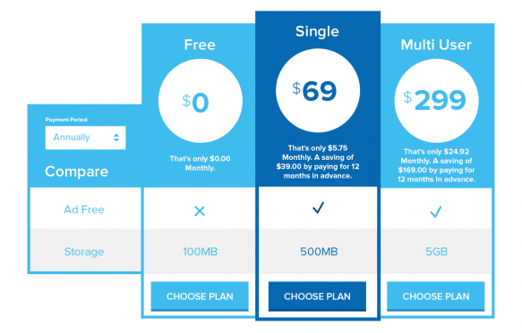

---

## 💳 Payment options

PS Bloghosting supports various payment processing methods.

Depending on the installed and enabled gateways, the available options include:

- PayPal Express
- PayPal Pro
- Stripe
- manual payments

You can select the available payment methods in the settings.

Checkout is integrated directly into PS Bloghosting, allowing users to select and pay for their hosting level.

---

## 📈 Statistics and reports

PS Bloghosting provides comprehensive statistics for your network.

You can monitor:

- active websites
- new registrations
- new upgrades
- cancellations
- active trial periods
- weekly activity
- monthly activity
- hosting-level distribution
- payment gateways
- historical trends
- terms and subscriptions

This gives you a quick overview of how your blog hosting network is developing.

---

## 🛠️ Easy website management

Management remains clear and straightforward even with a large number of websites.

You can:

- search websites
- change hosting levels
- control access permissions
- configure individual settings
- apply one-time setup fees
- manage recurring subscriptions
- customize individual websites
- manage upgrades and downgrades

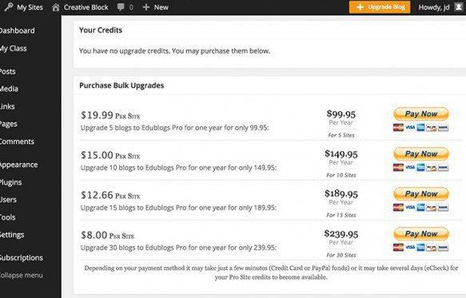

---

## 👥 BuddyPress and PS Community integration

PS Bloghosting can work with BuddyPress and PS Community.

For example, you can make specific BuddyPress or PS Community features available only to selected hosting levels.

These features include:

- group creation
- messaging
- other social features

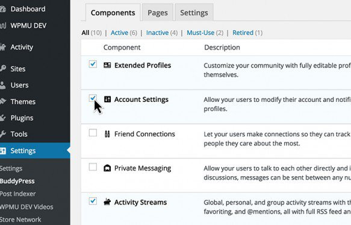

---

# 🧩 Modules

PS Bloghosting has a modular architecture.

You do not need to enable every feature. Instead, you can use only the modules your network actually needs.

Depending on the version and configuration, the available modules include:

### Advertising

Allows you to disable advertising for specific hosting levels.

Hosting levels can also allow users to disable advertising on additional websites.

### Bulk upgrades

Allows you to sell multiple upgrades as a package.

### BuddyPress and PS Community restrictions

Specific BuddyPress or PS Community features can be limited to selected hosting levels.

### Publishing limits

You can specify which hosting levels are allowed to publish posts and/or pages.

### Pay-to-Blog

A website can be completely locked until the user has a paid hosting level.

### Post and page limits

You can define how many posts, pages, or other content types a specific hosting level may create.

### Premium plugins

Premium plugins can be enabled specifically for selected hosting levels.

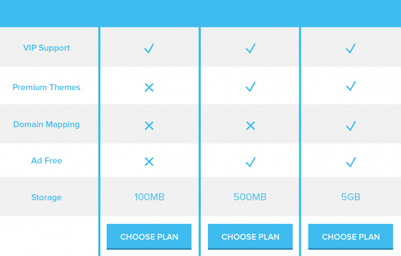

### Premium support

You can offer a dedicated support area for specific hosting levels.

### Premium themes

Specific themes can be made available exclusively to selected hosting levels.

### XML-RPC

XML-RPC can be restricted to specific hosting levels.

### Unfiltered HTML

The `unfiltered_html` capability can be enabled specifically for selected hosting levels.

### Upload limit

Additional storage space can be provided for specific hosting levels.

---

# 📧 Automatic email notifications

PS Bloghosting can send various emails automatically.

For example, you can:

- welcome new users
- confirm registrations
- send payment information
- inform users about changes
- send return offers after a cancellation

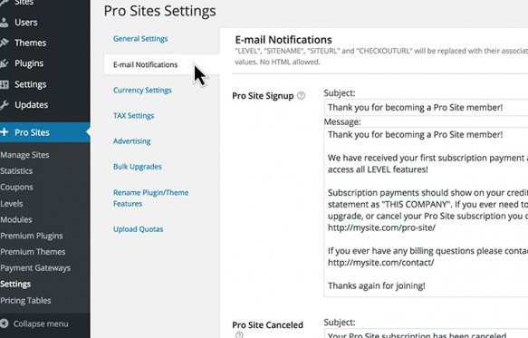

---

# 🎟️ Trial periods and coupons

You can offer free trial periods and use coupons.

This allows you to:

- encourage new users to upgrade
- create limited-time offers
- offer discounts
- create return offers for former customers

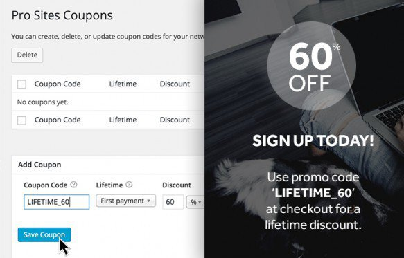

---

# ⚙️ Setup

## 1. Install the plugin

Install **PS Bloghosting** in your WordPress Multisite network.

Then activate the plugin under:

**Network Admin → Plugins**

and enable it **network-wide**.

---

## 2. Create hosting levels

After activation, first define your hosting levels.

You can create as many levels as you need.

For example:

- Free
- Basic
- Pro
- Business

You can define individual prices and features for each level.

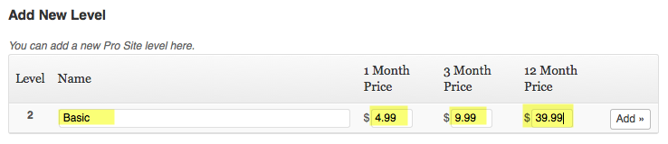

---

## 3. Configure the settings

The settings allow you to adapt PS Bloghosting to your own platform.

Available options include:

- branding
- names
- free trial periods
- email notifications
- payment options
- various hosting features

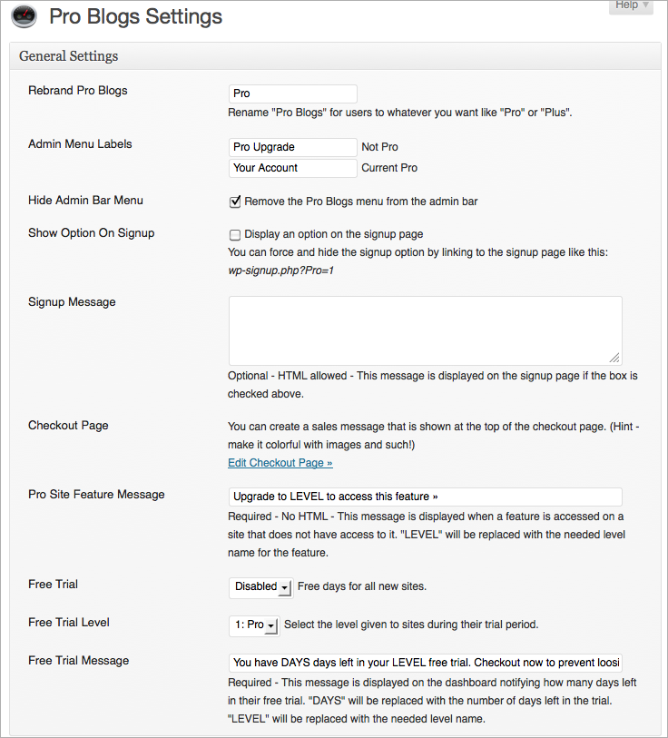

---

## 4. Enable modules

Under:

**PS Bloghosting → Modules / Gateways**

you can enable the modules and payment gateways you need.

Each module has its own settings.

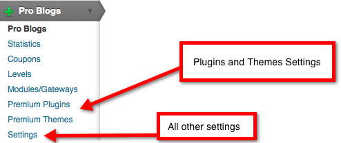

---

## 5. Configure payment gateways

You can then configure the desired payment gateways.

Depending on the available gateway support, you can use PayPal, Stripe, or manual payments, for example.

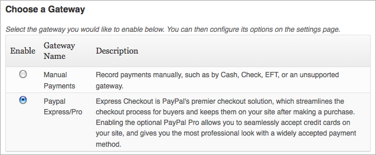

---

# 🛒 User upgrades

Once PS Bloghosting has been configured, users can upgrade their own website to a different hosting level.

The available hosting levels are presented in a clear overview.

The currently active level is highlighted.

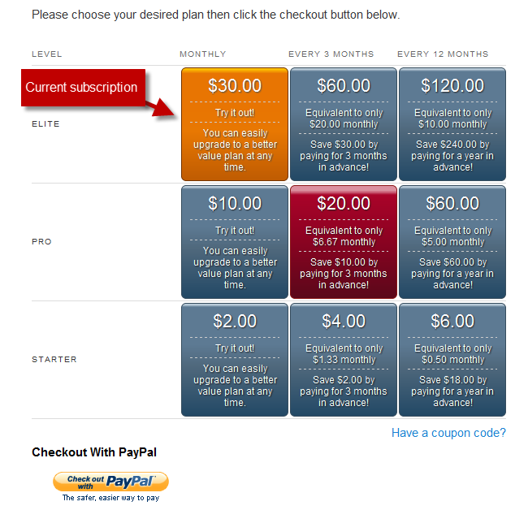

---

# 🔄 Upgrades and downgrades

When a hosting level changes, PS Bloghosting takes the remaining term of an existing subscription into account.

### Upgrade

When upgrading, the remaining period is taken into account and the amount due is calculated accordingly.

The new hosting level can therefore be used immediately.

### Downgrade

When downgrading, the lower hosting level takes effect for the following billing period.

---

# 📦 Premium plugins and themes

The corresponding modules allow you to assign plugins and themes to specific hosting levels.

For example, you can create a model like this:

| Hosting level | Plugins | Themes |
|---|---|---|
| Free | Basic | Basic |
| Basic | Selected premium plugins | Additional themes |
| Pro | All enabled plugins | Premium themes |
| Business | Full access | Full access |

This allows you to operate your Multisite installation flexibly as a complete hosting service.

---

# 📋 Feature overview

- [x] Custom branding
- [x] Upgrade buttons
- [x] Recurring subscriptions
- [x] One-time setup fees
- [x] Google Analytics integration
- [x] Unlimited hosting levels
- [x] Free hosting levels
- [x] Paid hosting levels
- [x] Free trial periods
- [x] Coupon management
- [x] Integrated pricing tables
- [x] Advertising module
- [x] Premium themes
- [x] Premium plugins
- [x] Custom email notifications
- [x] Bulk upgrades
- [x] Frontend checkout
- [x] PayPal
- [x] Stripe
- [x] Manual payments
- [x] Multiple currencies
- [x] Statistics
- [x] Subscription management
- [x] Refunds
- [x] Cancellation management
- [x] Global widgets
- [x] BuddyPress and PS Community integration
- [x] Ad-free hosting levels
- [x] Publishing limits
- [x] Pay-to-Blog
- [x] Post/page limits
- [x] Premium support
- [x] Upload limits
- [x] XML-RPC restrictions
- [x] Unfiltered HTML for selected levels

---

# 🧱 Architecture

PS Bloghosting was originally developed as **Pro Sites** for **WPMU DEV**.

The current version is developed under the name **PS Bloghosting** as part of the **PSOURCE** project.

The goal of this ongoing development is to modernize the code, replace outdated functionality, and improve compatibility with current PHP and WordPress versions.

---

# 🆓 Open source

PS Bloghosting is part of the **PSOURCE** project.

The focus is on:

- open source
- long-term maintainability
- current PHP compatibility
- more modern WordPress code
- transparent development
- as few unnecessary dependencies as possible

---

# ❤️ PSOURCE

**PSOURCE – Power-Source**

Open source from the Weserbergland region in Germany.

PSOURCE develops and modernizes open-source plugins and themes for WordPress and ClassicPress.

---

## 📜 License

PS Bloghosting is licensed under the open-source license specified for the project.

Please refer to the repository's license file for the complete license terms.
