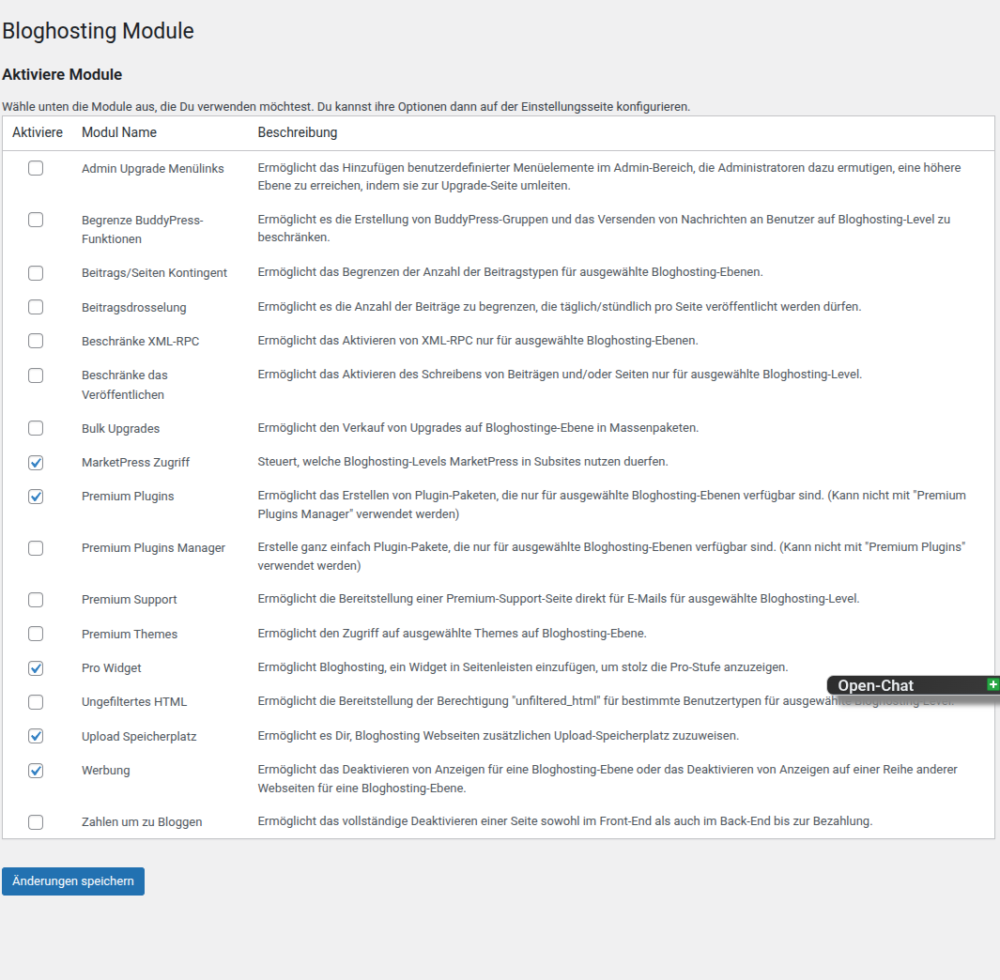
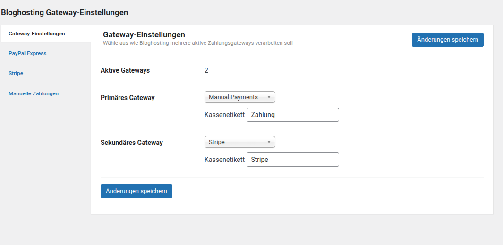

# Module und Zahlungen konfigurieren

[← Installation und Grundeinrichtung](index.md) · **Module und Zahlungen** · [Betrieb und Wartung →](operations.md)

PS Bloghosting ist modular aufgebaut. Aktiviere nur Funktionen, die Du tatsächlich anbietest und getestet hast.

---

## 1. Module aktivieren

Öffne **Netzwerkverwaltung → Bloghosting → Module**. Ein Häkchen aktiviert das jeweilige Modul netzwerkweit.

### Wichtige Module

| Modul | Aufgabe | Typischer Einsatz |
|---|---|---|
| Werbung | Werbung je Hosting-Level deaktivieren | werbefreie Premium-Pakete |
| BuddyPress/PS Community | Gruppen, Nachrichten und Blog-Tracking beschränken | Community-Netzwerke |
| Bulk Upgrades | mehrere Upgrades als Paket anbieten | Zusatzpakete |
| Beitrags-/Seiten-Limits | Anzahl veröffentlichbarer Inhalte begrenzen | abgestufte Redaktionspakete |
| Veröffentlichungs-Limits | Veröffentlichen von Beiträgen oder Seiten steuern | kostenlose Einstiegslevel |
| Pay-to-Blog | Frontend und Backend bis zur Zahlung sperren | vollständig kostenpflichtige Websites |
| Premium Plugins | Plugins nach Hosting-Level freigeben | Funktionspakete |
| Premium Themes | Themes nach Hosting-Level freigeben | Designpakete |
| Premium Support | eigenen Supportzugang anbieten | höherwertige Pakete |
| Ungefiltertes HTML | `unfiltered_html` gezielt erlauben | vertrauenswürdige Benutzer |
| Upload-Speicherplatz | zusätzliches Kontingent zuweisen | speicherbasierte Pakete |
| XML-RPC | XML-RPC nach Level einschränken | Sicherheits- und API-Vorgaben |

### BuddyPress und PS Community

Das Modul verwendet die kompatiblen Community-Schnittstellen und kann deshalb sowohl mit BuddyPress als auch mit PS Community zusammenarbeiten. Je nach Einstellung kannst Du:

- Gruppenerstellung auf bestimmte Hosting-Level beschränken
- das Verfassen von Nachrichten begrenzen
- unbezahlte Websites vom Blog-Tracking ausschließen
- einen individuellen Hinweis bei verweigertem Zugriff anzeigen

### Premium-Plugins richtig auswählen

**Premium Plugins** und **Premium Plugins Manager** dürfen nicht gleichzeitig verwendet werden. Entscheide Dich für eine Variante und teste die Plugin-Freigaben anschließend mit einem nicht administrativen Testkonto.

### Sicherheitsrelevante Module

Aktiviere `Ungefiltertes HTML` und XML-RPC nur, wenn Du die Auswirkungen kennst. Beide Funktionen können die Angriffsfläche erhöhen, wenn sie zu großzügig freigegeben werden.

---

## 2. Zahlungsgateways auswählen

Öffne **Bloghosting → Zahlungsgateways**. Im Reiter **Gateway-Einstellungen** bestimmst Du:

1. wie viele Gateways im Checkout angeboten werden
2. welches Gateway primär angezeigt wird
3. welches Gateway optional als zweite Zahlungsart verfügbar ist
4. welche Bezeichnung Benutzer im Checkout sehen

### Unterstützte Gateways

- **PayPal Express:** PayPal-basierte Onlinezahlungen
- **Stripe:** Karten- und weitere von Stripe unterstützte Zahlungen
- **Manuelle Zahlungen:** Banküberweisung oder individuell geprüfte Zahlung

Je nach Installation können weitere oder ältere Gateway-Module vorhanden sein.

---

## 3. Manuelle Zahlungen

Das manuelle Gateway eignet sich für Banküberweisungen und andere Zahlungen, die ein Netzwerkadministrator bestätigt.

Konfiguriere mindestens:

- Kontoinhaber
- IBAN
- optional BIC und Bankname
- verständliche Zahlungsanweisungen
- eindeutige Zahlungsreferenz
- Absender und Inhalt der Zahlungs-E-Mail

PS Bloghosting kann die Zahlungsdaten einschließlich EPC-QR-Code in der E-Mail bereitstellen. Prüfe den QR-Code mit einer Banking-App, bevor Du das Gateway öffentlich aktivierst.

### Ablauf

1. Der Benutzer wählt ein Paket und schließt den Checkout ab.
2. PS Bloghosting erstellt eine eindeutige Zahlungsreferenz.
3. Der Benutzer erhält die Überweisungsdaten per E-Mail.
4. Ein Netzwerkadministrator prüft den Zahlungseingang.
5. Die Website wird entsprechend freigeschaltet oder verlängert.

---

## 4. PayPal und Stripe

Für Onlinegateways gilt:

1. Verwende zunächst Test- beziehungsweise Sandbox-Zugangsdaten.
2. Prüfe erfolgreiche Zahlungen, Abbrüche und fehlgeschlagene Zahlungen.
3. Kontrolliere Rückleitungen zum Checkout.
4. Teste Verlängerung, Upgrade, Downgrade, Kündigung und Rückerstattung.
5. Wechsle erst danach auf Live-Zugangsdaten.

> **Zugangsdaten schützen:** API-Schlüssel, Webhook-Secrets und Passwörter gehören ausschließlich in die Gateway-Einstellungen. Veröffentliche sie niemals in Screenshots, Dokumentation oder Versionsverwaltung.

---

## 5. Checkout und Preistabelle testen

Führe vor der Veröffentlichung einen vollständigen Test mit einem normalen Benutzerkonto durch:

- [ ] Alle öffentlichen Pakete werden angezeigt.
- [ ] Preise, Währung und Laufzeiten stimmen.
- [ ] Das aktuelle Paket ist klar markiert.
- [ ] Primäres und sekundäres Gateway funktionieren.
- [ ] Erfolgs-, Abbruch- und Fehlerseiten sind verständlich.
- [ ] Bestätigungs-E-Mails werden zugestellt.
- [ ] Das neue Hosting-Level wird nach erfolgreicher Zahlung aktiv.
- [ ] Fehlgeschlagene Zahlungen schalten keine Premium-Funktionen frei.
- [ ] Upgrade und Downgrade berücksichtigen die verbleibende Laufzeit.

Weiter: **[Betrieb und Wartung →](operations.md)**

