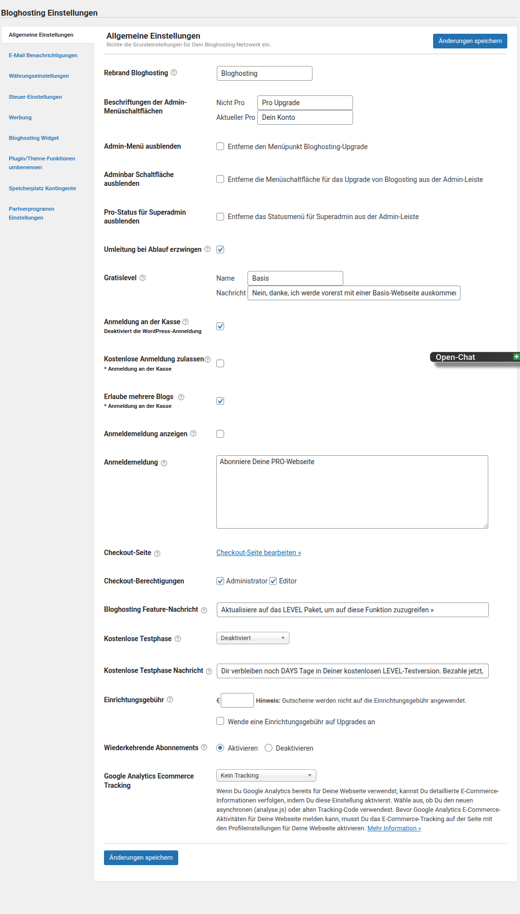
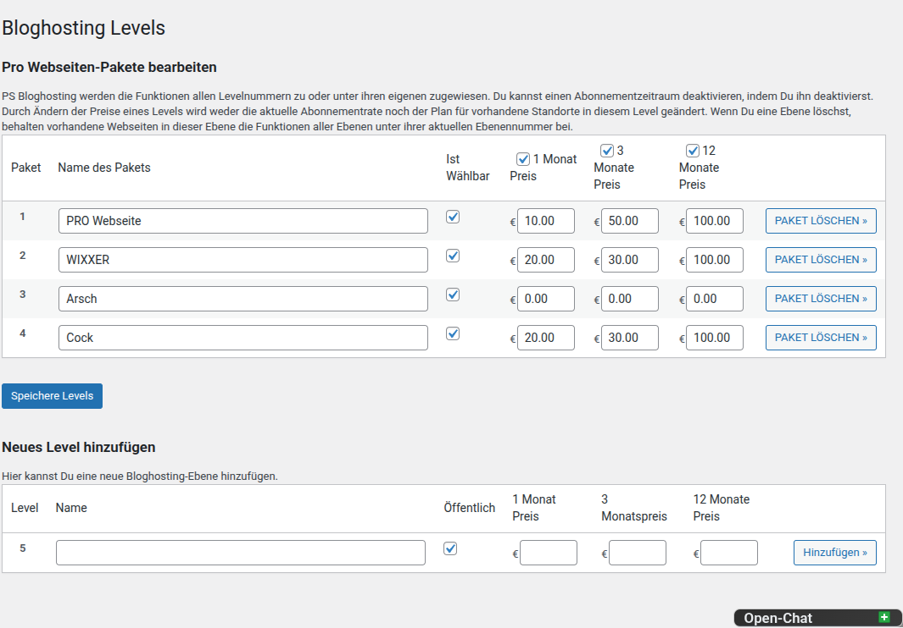

# PS Bloghosting – Handbuch

> Version 1.0.4 · WordPress/ClassicPress Multisite · Netzwerkweite Verwaltung

Dieses Handbuch führt Netzwerkadministratoren von der Installation bis zum laufenden Betrieb. Es ist bewusst auf drei Seiten aufgeteilt:

1. **[Installation und Grundeinrichtung](index.md)** – Plugin aktivieren, Grundeinstellungen festlegen und Hostingpakete erstellen
2. **[Module und Zahlungen](configuration.md)** – Funktionen freischalten, Gateways konfigurieren und Checkout vorbereiten
3. **[Betrieb und Wartung](operations.md)** – Webseiten, Gutscheine und Statistiken verwalten sowie Fehler eingrenzen

---

## 1. Voraussetzungen

Vor der Einrichtung benötigst Du:

- eine aktive WordPress- oder ClassicPress-Multisite
- ein Konto mit Netzwerkadministrator-Rechten
- PHP 8.0 oder neuer
- mindestens ein geplantes Hostingpaket
- bei kostenpflichtigen Paketen Zugangsdaten für das gewünschte Zahlungsgateway
- eine veröffentlichte Seite für den Checkout

> **Wichtig:** PS Bloghosting wird netzwerkweit verwaltet. Die nachfolgenden Menüs befinden sich unter **Netzwerkverwaltung → Bloghosting** und sind für normale Website-Administratoren nicht sichtbar.

---

## 2. Installation

1. Kopiere den Pluginordner `ps-bloghosting` nach `wp-content/plugins/`.
2. Öffne **Netzwerkverwaltung → Plugins**.
3. Aktiviere **PS Bloghosting** für das gesamte Netzwerk.
4. Öffne anschließend **Netzwerkverwaltung → Bloghosting → Einstellungen**.

Nach der Aktivierung stehen folgende Hauptbereiche zur Verfügung:

| Bereich | Zweck |
|---|---|
| Seitenverwaltung | Hostingstatus einzelner Websites prüfen und ändern |
| Statistiken | Aktivität, Upgrades, Kündigungen und Verteilung auswerten |
| Gutscheine | Rabattcodes erstellen und verwalten |
| Hostingpakete | Level, Preise und Abrechnungszeiträume definieren |
| Module | optionale Funktionen aktivieren |
| Zahlungsgateways | Zahlungsanbieter auswählen und konfigurieren |
| Einstellungen | Checkout, E-Mails, Währung und allgemeines Verhalten festlegen |
| Preistabelle | Darstellung der Pakete im Frontend konfigurieren |

---

## 3. Grundeinstellungen

Öffne **Bloghosting → Einstellungen**. Die Reiter bündeln alle globalen Optionen:

- **Allgemeine Einstellungen:** Bezeichnungen, Checkout-Seite, Berechtigungen und kostenlose Testphase
- **E-Mail-Benachrichtigungen:** Texte und Absender für Systemnachrichten
- **Währungseinstellungen:** Währung, Symbol und Zahlungsdarstellung
- **Steuern:** steuerbezogene Einstellungen
- **Werbung:** Vorgaben des Werbemoduls
- **Pro-Widget:** Darstellung des Upgrade-Widgets
- **Umbenennung:** eigene Bezeichnungen für Pakete und Funktionen
- **Upload-Quota:** netzwerkweite Speichergrenzen
- **Affiliate:** Zuordnung von Partnerempfehlungen

### Empfohlene Reihenfolge

1. Lege Namen und Texte für Dein Hostingangebot fest.
2. Wähle oder erstelle die Checkout-Seite.
3. Begrenze die Checkout-Berechtigung auf geeignete Benutzerrollen.
4. Aktiviere bei Bedarf eine kostenlose Testphase.
5. Prüfe Währung, Dezimaltrennzeichen und Währungssymbol.
6. Passe Absender und Inhalte der automatischen E-Mails an.
7. Speichere jeden Reiter, bevor Du zum nächsten wechselst.

### Platzhalter in Nachrichten

Einige Texte unterstützen dynamische Platzhalter, beispielsweise:

- `LEVEL` – Name des Hostingpakets
- `DAYS` – verbleibende Tage einer Testphase

Behalte diese Platzhalter beim Übersetzen oder Anpassen unverändert bei.

---

## 4. Hostingpakete erstellen

Öffne **Bloghosting → Hostingpakete**. Jedes Paket entspricht einem Hosting-Level. Höhere Level erhalten grundsätzlich auch die Funktionen niedrigerer Level.

### Neues Paket anlegen

1. Trage eine eindeutige Levelnummer ein.
2. Vergib einen verständlichen Namen, etwa `Basic`, `Pro` oder `Business`.
3. Lege fest, ob das Paket öffentlich auswählbar ist.
4. Trage Preise für die gewünschten Laufzeiten ein.
5. Speichere das neue Level.

### Abrechnungszeiträume

In der Tabellenüberschrift kannst Du Laufzeiten wie einen, drei oder zwölf Monate aktivieren. Deaktivierte Laufzeiten erscheinen nicht im Checkout.

### Beispielstruktur

| Level | Zielgruppe | Typische Freigaben |
|---|---|---|
| Kostenlos | Einstieg | Grundfunktionen, begrenzter Speicher |
| Basic | kleine Websites | mehr Speicher, werbefrei |
| Pro | professionelle Websites | Premium-Plugins und Themes |
| Business | Agenturen und Unternehmen | vollständiger Funktionsumfang |

> **Bestehende Abonnements:** Preisänderungen wirken nicht automatisch rückwirkend auf bereits laufende Abonnements. Prüfe bestehende Websites und Verträge nach größeren Änderungen separat.

### Checkliste vor dem nächsten Schritt

- [ ] Mindestens ein öffentlich auswählbares Paket existiert.
- [ ] Preise und Laufzeiten sind vollständig.
- [ ] Das kostenlose Paket ist klar von kostenpflichtigen Paketen abgegrenzt.
- [ ] Checkout-Seite und Währung sind eingerichtet.
- [ ] Texte für Testphase, Upgrade und Kündigung sind geprüft.

Weiter: **[Module und Zahlungen konfigurieren →](configuration.md)**

