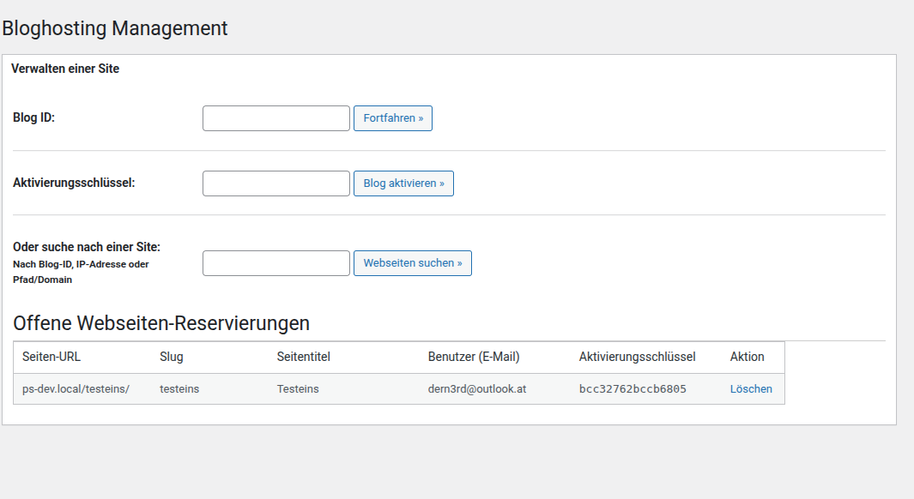
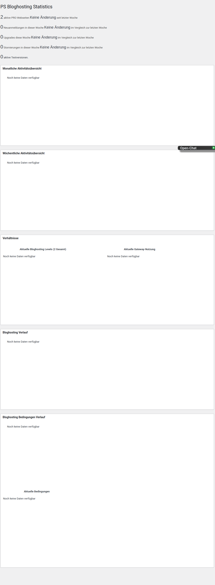

# Betrieb und Wartung

[← Module und Zahlungen](configuration.md) · **Betrieb und Wartung** · [Zum Anfang](index.md)

Diese Seite beschreibt die tägliche Verwaltung nach der Einrichtung.

---

## 1. Websites verwalten

Öffne **Netzwerkverwaltung → Bloghosting → Seitenverwaltung**. Du kannst Websites über Blog-ID, IP-Adresse, Domain oder Pfad finden.

Typische Aufgaben:

- aktuelles Hosting-Level prüfen
- Paket manuell ändern
- Laufzeit und Status kontrollieren
- Upgrade oder Downgrade nachvollziehen
- individuelle Website-Einstellungen anpassen
- offene Website-Reservierungen bearbeiten
- Zahlungs- oder Abonnementprobleme untersuchen

### Empfohlener Ablauf bei manuellen Änderungen

1. Suche die Website eindeutig über Blog-ID oder Domain.
2. Dokumentiere den aktuellen Status.
3. Prüfe Zahlung, Laufzeit und bisheriges Hosting-Level.
4. Nimm die Änderung vor.
5. Kontrolliere Frontend, Backend und freigeschaltete Module.
6. Informiere den Benutzer über die Änderung.

---

## 2. Gutscheine verwalten

Unter **Bloghosting → Gutscheine** kannst Du Rabattcodes erstellen, bearbeiten, importieren und deaktivieren.

Lege für jeden Gutschein fest:

- eindeutiger Code
- Rabattart und Rabatthöhe
- erlaubte Hosting-Level
- Gültigkeitszeitraum
- maximale oder verbleibende Verwendungen

### Empfehlungen

- Verwende keine leicht erratbaren Codes für vertrauliche Angebote.
- Setze für Kampagnen immer ein Enddatum.
- Teste den Gutschein mit jedem erlaubten Abrechnungszeitraum.
- Prüfe, ob der Rabatt nur einmal oder auch bei Verlängerungen gilt.
- Deaktiviere abgelaufene Kampagnen, statt Codes erneut zu verwenden.

---

## 3. Statistiken auswerten

Öffne **Bloghosting → Statistiken**. Die Übersicht zeigt unter anderem:

- aktive PRO-Websites
- neue Anmeldungen
- Upgrades und Kündigungen
- monatliche und wöchentliche Aktivität
- Verteilung der Hosting-Level
- verwendete Zahlungsgateways
- historische Entwicklungen
- aktuelle Abonnementbedingungen

### Sinnvolle Routine

| Intervall | Prüfung |
|---|---|
| täglich | fehlgeschlagene Zahlungen und offene Reservierungen |
| wöchentlich | neue Upgrades, Kündigungen und Gateway-Nutzung |
| monatlich | Paketverteilung, Umsatzentwicklung und Testphasen |
| vor Preisänderungen | aktive Abonnements und bestehende Vertragsbedingungen |

---

## 4. E-Mails und Zustellung

Prüfe regelmäßig:

- Absendername und Absenderadresse
- Registrierungs- und Willkommensnachrichten
- Zahlungsanweisungen
- Upgrade- und Downgrade-Benachrichtigungen
- Erinnerungen an auslaufende Testphasen
- Kündigungs- und Rückkehrangebote

Nutze für Produktion eine zuverlässig konfigurierte Mailzustellung und teste HTML- sowie Textdarstellung in mehreren E-Mail-Programmen.

---

## 5. Updates und Wartung

Vor jedem Update:

1. Erstelle eine vollständige Sicherung von Dateien und Datenbank.
2. Sichere insbesondere Plugin-Einstellungen und Zahlungsdaten.
3. Teste das Update nach Möglichkeit in einer Staging-Umgebung.
4. Prüfe anschließend Checkout, Gateways, E-Mails und Level-Freigaben.
5. Kontrolliere die Statistiken und mindestens eine bestehende PRO-Website.

Nach Änderungen an Modulen oder Paketen solltest Du zusätzlich bestehende Websites kontrollieren, da laufende Abonnements nicht automatisch jede neue Preis- oder Paketlogik übernehmen.

---

## 6. Fehlerbehebung

### Das Menü „Bloghosting“ fehlt

- Prüfe, ob das Plugin netzwerkweit aktiviert ist.
- Stelle sicher, dass Du als Netzwerkadministrator angemeldet bist.
- Beende aktive Benutzer- oder Mitgliedschaftssimulationen.
- Lade die Netzwerkverwaltung anschließend neu.

### Ein Paket erscheint nicht im Checkout

- Prüfe, ob das Level öffentlich auswählbar ist.
- Aktiviere mindestens einen Abrechnungszeitraum.
- Kontrolliere Preis und Währung.
- Prüfe die Preistabellen- und Checkout-Einstellungen.

### Premium-Funktionen fehlen

- Prüfe, ob das zugehörige Modul aktiv ist.
- Kontrolliere die Mindestlevel-Einstellung des Moduls.
- Teste mit einem normalen Benutzer statt mit einem Netzwerkadministrator.
- Verwende nicht gleichzeitig **Premium Plugins** und **Premium Plugins Manager**.

### Eine Zahlung schaltet das Paket nicht frei

- Kontrolliere Gateway-Konfiguration und Transaktionsstatus.
- Prüfe bei manuellen Zahlungen die Zahlungsreferenz.
- Kontrolliere die Website in der Seitenverwaltung.
- Prüfe die E-Mail- und PHP-Fehlerprotokolle.
- Ändere das Hosting-Level nur manuell, wenn die Zahlung eindeutig bestätigt ist.

### PS Community oder BuddyPress wird nicht beschränkt

- Aktiviere das Modul **Begrenze BuddyPress-Funktionen**.
- Prüfe Gruppen-, Nachrichten- und Blog-Tracking-Einstellungen.
- Kontrolliere die zugewiesenen Hosting-Level.
- Leere gegebenenfalls relevante Objekt- und Seiten-Caches.

---

## 7. Abschlusscheck für den Produktivbetrieb

- [ ] Netzwerkweites Backup vorhanden
- [ ] Hostingpakete und Preise geprüft
- [ ] Module bewusst ausgewählt
- [ ] Checkout mit normalem Benutzer getestet
- [ ] Online- und manuelle Zahlungen getestet
- [ ] E-Mail-Zustellung bestätigt
- [ ] Gutscheine und Testphasen geprüft
- [ ] Upgrade, Downgrade und Kündigung getestet
- [ ] PS Community/BuddyPress-Regeln getestet
- [ ] Statistiken und Seitenverwaltung erreichbar
- [ ] API-Schlüssel und Zahlungsdaten nicht öffentlich dokumentiert

Zurück: **[Installation und Grundeinrichtung](index.md)**

